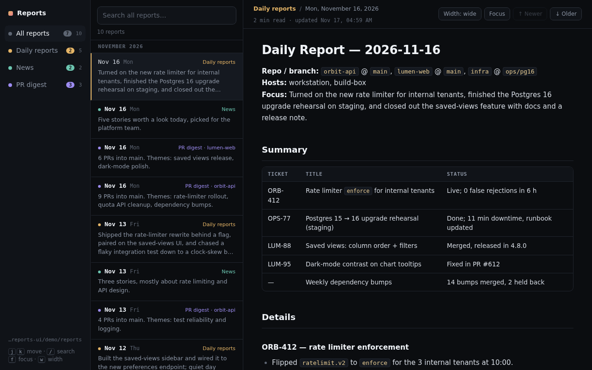

# reports-ui

Dark web reader for the plain-file reports under `$REPORTS_HOME` (daily reports, PR
digests, and whatever kind comes next). One small Node server, no build step, no database.



The GIF uses the fictional reports in [`demo/reports`](demo/reports); try them with
`npm install && npm run demo` (http://127.0.0.1:4401). `npm run capture` regenerates the
GIF from them (headless Chrome via puppeteer, GIF via gifenc; add
`-- --frames <dir>` to keep each GIF frame as a PNG).

A report is any `<YYYY-MM-DD>.md` or `<YYYY-Qn>.md` below the root. Its top-level folder is
the **kind**; folders between the kind and the year are the **group**:

```
daily-reports/2026/2026-11-16.md                 kind daily-reports
pr-digest/architect-service/2026/2026-11-16.md   kind pr-digest, group architect-service
```

A new kind needs no code: add the folder and it appears in the sidebar. Files are read
live, so a report written by a timer shows up within a minute (or on window focus).

## Run

```bash
npm install
REPORTS_HOME=~/ixuok/reports npm start          # http://127.0.0.1:4400
REPORTS_HOME=~/ixuok/reports scripts/install-service.sh   # keep it running (systemd user unit)
scripts/install-service.sh uninstall
```

| Env | Default | |
|---|---|---|
| `REPORTS_HOME` | `~/reports` | reports root |
| `PORT` | `4400` | |
| `HOST` | `127.0.0.1` | there is no login; set `0.0.0.0` only on a network you trust with the reports |

From another machine: `ssh -L 4400:127.0.0.1:4400 <host>`, then open `http://localhost:4400`.

## Using it

- Sidebar picks the kind, chips pick the group, search is full text across every report.
- `j` / `k` older / newer, `/` search, `Esc` clear.
- `f` hides the side panels (focus), `w` cycles the reading width: comfort, wide, full.
- A dot marks a report that is new or was rewritten since you last opened it (kept per browser).

## Layout

- `server.js` — the whole backend, Node built-ins only: scans the root, serves
  `/api/index`, `/api/report?path=`, `/api/search?q=` and the static UI. Read-only.
- `demo/reports/` — fictional reports for the demo and the GIF.
- `scripts/capture.js` — renders `docs/tour.gif` from the demo reports.
- `public/` — the UI, no build step. Markdown is rendered in the browser by `marked`
  (served from `node_modules`); raw HTML in a report is shown as text and a CSP blocks scripts.

## License

MIT — see [LICENSE](LICENSE).
